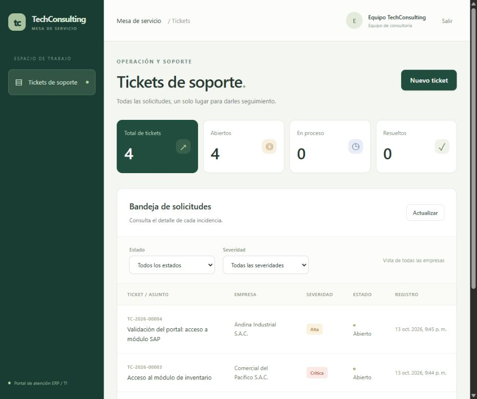

# Verificación del primer incremento

## Resultados

| Comprobación | Resultado |
| --- | --- |
| API con H2 en modo PostgreSQL | 9 pruebas aprobadas, 0 fallos |
| Misma API con PostgreSQL 17.11 real | 9 pruebas aprobadas, 0 fallos |
| React con Vitest y Testing Library | 3 pruebas aprobadas, 0 fallos |
| TypeScript y compilación Vite | Correcto |
| Maven package y JAR ejecutable | Correcto |
| Maven Wrapper 3.9.11 | Correcto |
| Formato Prettier | Correcto |
| npm audit --omit=dev | 0 vulnerabilidades reportadas en dependencias de ejecución |
| Navegador conectado a Spring Boot/PostgreSQL | Login, creación, detalle y separación de clientes comprobados |
| Consola de navegador durante la prueba | Sin errores o advertencias capturados |

No se ejecutó un análisis completo de vulnerabilidades Maven. El resultado de npm audit cubre exclusivamente las dependencias de ejecución del frontend al momento de la consulta.

## Prueba real en navegador

Se inició sesión como cliente de Andina, se creó el ticket ficticio TC-2026-00004 y se comprobó su descripción y solicitante en el detalle. Los indicadores cambiaron de dos a tres tickets para Andina.

Luego se inició sesión como cliente de Comercial del Pacífico: solo apareció su ticket de inventario y el ticket de Andina no estuvo presente. Finalmente, el perfil interno mostró los cuatro tickets y permitió seleccionar cualquiera de las dos empresas en el formulario.

La aplicación se verificó mediante http://localhost:5173, con la API en 127.0.0.1:8080 y PostgreSQL del proyecto en localhost:55432. No se modificó el PostgreSQL instalado del equipo.



## Repetir la comprobación PostgreSQL

```powershell
# Desde la raíz, con el contenedor del proyecto iniciado
.\scripts\Test-Postgres.ps1
```

El script utiliza la base dedicada tickets_test en el contenedor del proyecto, distinta de tickets. Conserva los datos de prueba y no borra registros del sistema.

## Limitaciones funcionales

Este incremento cubre acceso y tickets. No incluye cambio de estados, asignación de consultores, contratos, imputaciones, cálculo SLA ni reportes. Esas funciones se mantienen en el backlog de la entrega final, sin pantallas que simulen su disponibilidad.
